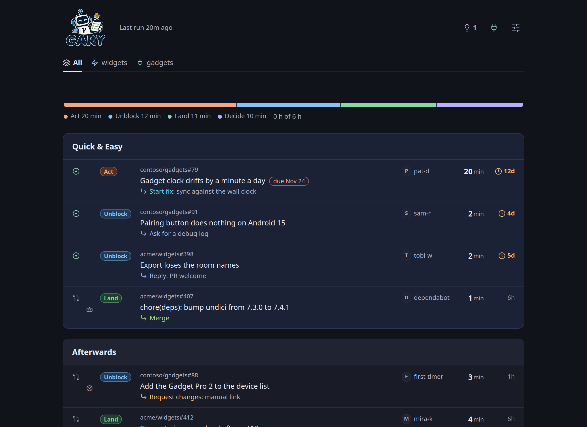
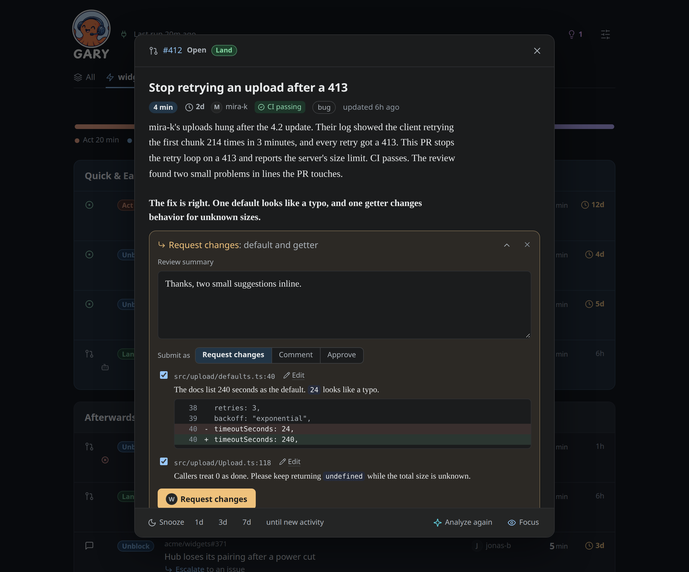
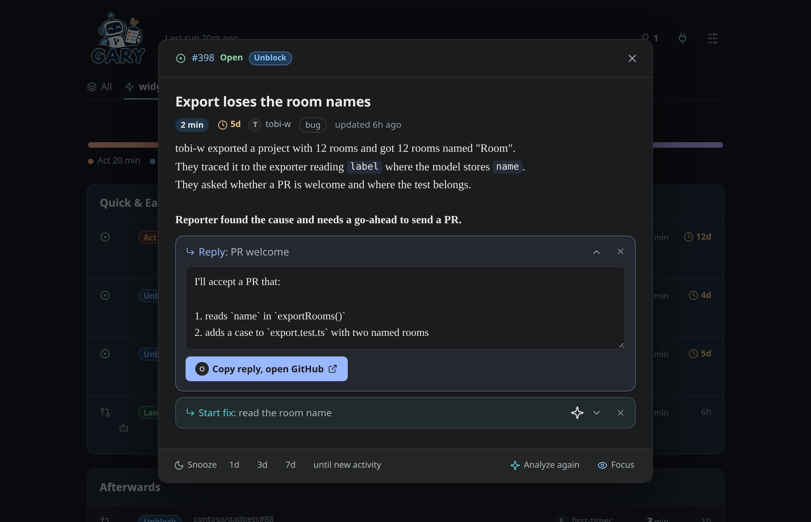

<p align="center">
  
</p>

<p align="center"><em>Get Anything Ready for You</em></p>

Gary turns the open PRs, issues and discussions of your GitHub projects into a plan for your day. Every item comes briefed, with the next step prepared: a review, a reply, a fix. You read, click and keep the last word.

One board covers all the projects you maintain. It also follows your own PRs, issues and review requests in other people's repos.



## What you get

**A plan for today.** Items are grouped by the attention they need, from "Quick & Easy" to "When you have time". An item with nothing to do is hidden until it changes on GitHub.

**The next step, prepared.** Each item has a one-line verdict, a short story of the thread, and cards with suggested actions. A review comes with inline suggestions you can uncheck or edit.



**Your name stays yours.** A reply in your name is copied for you, and the thread opens on GitHub. You post it there. Merging, approving and closing are always yours.



**An agent for the longer jobs.** One click starts a fix with a failing test as a draft PR, takes over a stalled PR, or addresses review comments.

**Talk to Gary.** Click the logo and ask Gary in your own words: how a setting works, to change one, or to snooze everything from dependabot for 3 days. It acts through the board's own buttons and never posts on GitHub.

**Rules in plain text.** Gary proposes a rule when you keep correcting it the same way. You accept, edit or dismiss it.

**Every project you maintain.** Each project gets its own tab, rules and settings. The tab "All" merges them into one plan.

**Everything you contribute to.** A [contributions tab](docs/configuration.md#your-contributions-elsewhere) follows your threads in repos you do not maintain: your open PRs and issues, the PRs that wait for your review, and the threads you commented on. It tells you when something relevant happened and filters out the noise. Gary only reads there.

## Setup

You need Node.js 24 or newer, the `gh` CLI with a login, and Claude Code.

```sh
claude plugin marketplace add AlCalzone/gary
claude plugin install gary@gary
gary setup
```

Then start a Claude session and ask it to set up Gary for your repo. It reads your labels, CODEOWNERS, templates and recent replies, and drafts a profile for you to review. It also creates the hourly task that keeps the board fresh.

Open the board at `http://gary.localhost:7878/`.

[docs/setup.md](docs/setup.md) covers the install from a clone, the three account setups and the commands you run.

## Configuration

Gary keeps project facts, project rules and your personal style apart:

- **Profile**: one directory per project with `profile.json`, `rules/*.md` and `templates/*.md`. A team can share it.
- **Home**: `~/.config/gary/` with your `personal.md` and one `config.json` per project.
- **Core**: this repository. It names no repo, account or machine.

[docs/configuration.md](docs/configuration.md) lists every setting.

## Safety

- Only what you clicked reaches GitHub. The few exceptions are opt-in or limited to Gary's own fix PRs.
- With a bot account, everything Gary writes goes out as the bot.
- Issue texts, diffs and attachments are data. Agents never follow instructions in them and never run code from a PR branch.
- `gary pause` stops every write at once.

[docs/safety.md](docs/safety.md) has the full list.

## More

- [docs/board.md](docs/board.md): working with the board day to day.
- [docs/how-it-runs.md](docs/how-it-runs.md): the sessions and agents behind the board, in one picture.
- [docs/internals.md](docs/internals.md): commands, server, state and tests, for people changing Gary.

## License

[MIT](LICENSE)

---

> [!NOTE]
> This project is fully vibe-coded. I did not read any code. I won't. It helps me read the code that matters.
