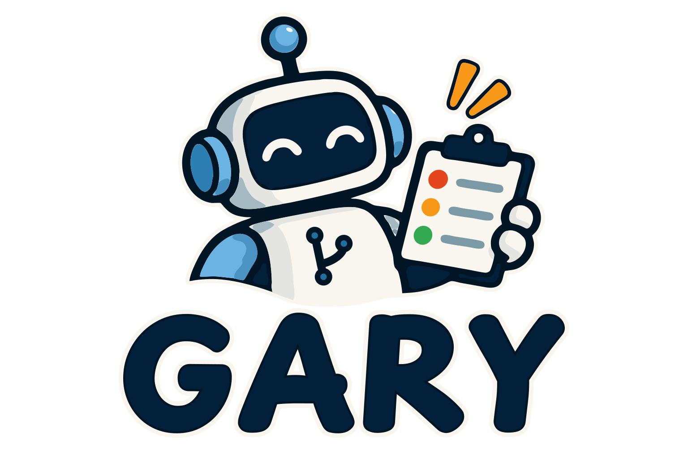

<p align="center">
  
</p>

<p align="center"><em>Get Anything Ready for You</em></p>

Gary turns the open PRs, issues and discussions of your projects into a plan for your day.

- **Know what matters in a minute.** Every item comes with a short briefing: what happened, who is waiting, and how long it will take you.
- **The next step is already prepared.** A review with inline suggestions, a reply in your voice, a fix with a test. You read it and click.
- **You keep the last word.** Gary never merges, approves or closes. Those stay with you.
- **It learns how you work.** Dismiss a suggestion or rewrite a draft, and Gary proposes a rule for next time.

<!-- Screenshot of the board goes here. -->

## Who does what

| You | The agent |
| --- | --- |
| Install Gary once and run `gary setup` | Runs one master Claude session per machine, which starts a worker per project every hour |
| Create your project profile with the `triage-setup` skill | Fetches the repo's state, reviews PRs, triages issues and discussions |
| Open the board and read the briefings | Writes the briefings and suggested actions to the board |
| Click the suggestions you agree with, or dismiss them | Carries out what you clicked: reviews, fixes, changes to PRs, replies by the bot |
| Merge, approve and close on GitHub | Opens fix PRs for clear bugs and takes them through review rounds |
| Edit the rules as plain text | Proposes new rules from your decisions |
| Pause and resume Gary | Runs every other `gary` command |

The commands you run yourself are listed under [Commands you run](#commands-you-run). Every other `gary` command is for the agent. [docs/internals.md](docs/internals.md) describes them.

## Install

As a Claude Code plugin, the repository is its own marketplace:

```sh
claude plugin marketplace add <git URL or path of this repository>
claude plugin install gary@gary
gary setup
```

From a plain clone:

```sh
git clone <git URL> ~/repositories/gary
cd ~/repositories/gary && npm install
bin/gary setup --register-mcp
```

`gary setup` asks in the terminal for your GitHub login, the first repo, its local checkout and the account setup. It creates the home directory, by default `~/.config/gary/`, with a shared, empty `personal.md`, and one instance in `instances/<name>/` with `config.json` and `state/`. It never overwrites an existing `config.json` without `--force` and never touches an existing `personal.md`. From a clone it also links the skills into `~/.claude/skills` and the `gary` command into `~/.local/bin`, and registers the MCP server with `--register-mcp`.

### Accounts

Pick one of three setups:

- **With a bot account**: replies, reviews, labels and pushes that you approve go out as the bot. `setup` asks for its login and a file with its token. This is the setup with the most one-click actions.
- **Without a bot**: Gary prepares texts, and you post them yourself on GitHub. Actions without a text, like a transfer, a label or inline review comments, are not offered. Agents push nothing.
- **Without a bot, own token allowed** (`allowOwnTokenPushes`): like the first setup, but everything runs under your own `gh` login.

### Create the profile

Start a Claude session and ask it to set up Gary. The `triage-setup` skill reads your repo, read-only: labels, CODEOWNERS, the contributing guide, issue templates, workflows and your recent replies. It drafts the profile for you to review:

- `profile.json`: the repo, maintainers, bot logins, related repos, sensitive paths, labels Gary may set on its own, bot commands.
- `rules/*.md`: how items are classified, how you write, how PRs and issues are reviewed in this project.
- `templates/*.md`: canned texts, like a request for logs.

It asks only what it cannot read: your login, whether a bot posts for you, your writing preferences for `personal.md`. Then it runs `gary doctor` and creates the one hourly scheduled task for the machine, if it does not exist yet. It never writes to GitHub.

## Daily use

Open the board at `http://127.0.0.1:<port>/`, with the port from `~/.config/gary/config.json`. One board serves all your projects: the tab "All" combines them, and each project has its own tab. In "All", items show their full ref, like `acme/widgets#412`. Items are grouped by how much attention they need, from "Quick & Easy" to "When you have time". An item with nothing to do right now is not shown. It comes back when it changes on GitHub. An issue or discussion with a fix in progress leaves the groups too: the fix PR carries the work, and the line "Has a fix in progress" below the groups lists such items until the PR is merged or closed, or the reporter writes again.

Each item has a short verdict, a story of what happened so far, and cards with suggested actions. One card is recommended. A card shows who acts after your click:

- **You**: replies to people, every close and every merge. The board copies the text and opens the thread on GitHub. You post or merge there yourself.
- **The bot**: reviews with inline comments, requests for logs, labels, transfers. They are sent after your click. Anything that posts text asks for a second confirm first.
- **The agent**: work that takes a session, like taking over a contributor's PR, changing a PR we already control, addressing review comments, or writing a fix with a test as a PR. The request starts within seconds.

A card whose action is done collapses and shows its confirmation in its header row, like "Done · view on GitHub" or "Copied and opened on GitHub, 21:42". An item you handled leaves the plan when you close it and waits in the line "Handled, waiting for the next run".

After the agent pushed to a PR, the item offers the decision: merge, a review with what is left, or another pass by the agent. While the agent is changing a PR, the cards that decide it are hidden.

Gary's reviews never list formatting problems. When the project's formatter or lint autofix would change a PR, the item shows a badge and a "Format" card that commits exactly those fixes to the PR, without taking it over.

**One review can go out without your click, and it is off by default.** With `"autoReview": { "enabled": true }` in the instance's `config.json`, a PR by an outside contributor that only touches the paths your profile names in `autoReviewPaths` gets one review from the bot before you first look at it. It holds only findings the agent is certain about and can show with a concrete case, as a change request, and ends with "A maintainer will review this PR after these are addressed." Questions, taste and everything uncertain stay on your own card. When the formatter would change the PR, the review offers once to push that as one commit, and does it when the PR's author answers with a thumbs-up or a yes. The PR then waits in the line "Reviewed automatically, waiting" below the groups and returns to your plan when the contributor pushes, replies or re-requests a review. Its card shows what was asked and what changed since. `gary doctor` shows the setting.

A reply that asks the reporter for something has a second button that also sets the project's "waiting" label, and the label is set by the next run when you post without it.

On review cards you can uncheck inline comments and switch each open review thread between Fix and Dismiss. Only comments the agent judged valid start on Fix. A review with a finding goes out as "Request changes", a clean PR gets an approval, and a switch on the card lets you pick another type before sending.

The card that starts a fix has a switch "Ask the reporter to test", off by default. Without it, a fix PR mentions nobody and asks nobody to confirm.

When a suggestion is wrong, dismiss its card and say why. The agent never offers that kind of action on the item again and takes your reason into account. "Analyze again" sends the item back to the agent, optionally with a note.

Items Gary could not analyze show one card that opens the thread on GitHub, so you decide yourself. That happens when the model's safety filter stopped the agent or the analysis failed three times. "Analyze again" retries.

Gary learns from your decisions. When you often dismiss the same kind of card, pick the alternative, or rewrite drafts the same way, it proposes a small rule. Proposals appear on the board. You edit, accept or dismiss them. An accepted rule is appended to your profile or `personal.md`.

## Commands you run

Run these in any terminal. `gary` reads its settings from `~/.config/gary/`. You never run them inside the triage session. That session calls `gary` on its own and shares the same settings and state.

With one project, the current folder does not matter. With several, `gary` picks the instance from where you run it: inside a project's checkout or one of its worktrees, `gary pause` pauses that project. Elsewhere, name it with `--instance <name>`, or use `--all` with `pause`, `resume` and `doctor`. When `gary` cannot tell which instance you mean, it lists them and does nothing. Commands that change something print the instance they acted on.

From a clone, `gary setup` links the command into `~/.local/bin`, which must be on your `PATH`. A plugin install puts `gary` on the `PATH` inside Claude Code sessions only. There you run a command by typing `! gary pause` in a session, or you ask Claude to run it.

- `gary setup`: install or reconfigure Gary on this machine. `gary setup --instance <name>` adds a project.
- `gary instances`: list the projects on this machine.
- `gary doctor`: check the installation without changing anything: Node, `gh` and its login, the bot token, the profile, the checkout, the port, the skill links, the pause switch, and whether the automatic review is on.
- `gary pause`: stop every write to GitHub at once. The board stays up, nothing needs a restart.
- `gary resume`: end the pause.
- `gary decisions --since <date>`: show the log of your decisions that Gary learns from.
- `gary proposals`: list the rule proposals and their status.
- `gary validate`: check the stored items against the rules, read-only.
- `gary auto-review list`: show the reviews Gary posted without a click, and which PRs still wait for their contributor.

While paused, every click that would post, review, label or transfer is refused with "Gary is paused. Nothing was sent." Agent requests still queue and start after `gary resume`. Snoozing, dismissing a suggestion and deciding rule proposals keep working. The board header shows the pause.

## Several projects

One machine can run Gary for several repos. Each repo gets its own instance with its own settings, pause switch and decision log, and its own tab on the one board. Ask Claude to set up Gary for the next repo, and the `triage-setup` skill creates a new instance next to the existing ones. The board picks it up without a restart, and the next hourly run includes it. Your shared `personal.md` applies to all instances. Each instance can add its own `personal.md` on top. Instances of the same project on different machines can share one profile.

One master Claude session runs everything, started every hour by one scheduled task. It starts the board server, starts one worker per instance for the triage, and watches the queue of all instances to start a worker for each request you click. A worker is a child session where the harness supports it, otherwise a headless `claude -p` run, otherwise the master does the job itself. Workers report only by writing files into their instance's state, so nothing depends on messages between sessions.

`gary serve` starts the board server without a Claude session. `gary migrate` moves an installation from the older one-board-per-instance layout to this one.

## Adapting Gary

Gary has three layers. Each kind of change has one place:

- **Core**: this repository. It holds no repo name, no account name and no path of one machine, so nobody edits it to adapt the tool. `profiles/template/` is the skeleton for a new profile.
- **Profile**: one directory per project, named by `profile` in `config.json`. It can live in its own repo or inside your project, so a team can share it. Project facts go into `profile.json`, project rules into `rules/classification.md`, `rules/voice.md`, `rules/review.md` and `rules/issues.md`, canned texts into `templates/`.
- **Home**: `~/.config/gary/` or `$GARY_HOME`. `personal.md` holds your own rules and writing style for all projects. `config.json` holds the board's port. Each instance lives in `instances/<name>/` with its `config.json`, an optional `personal.md` for that project, and `state/` with the board's data.

Quick classification of obvious items, like a green dependency update or an item waiting on its reporter, can run on a smaller, faster model. `fastTier` in the instance's `config.json` controls it: `off` by default, `shadow` to let it run next to the standard model without effect, `on` to use it. In shadow mode Gary compares both and proposes switching to `on` once they agree on at least 95 percent of 40 or more items. In `on` mode it keeps checking a sample against the standard model and against your own decisions, and proposes going back to `shadow` when the fast model falls behind. `gary shadow report --week` shows the numbers.

The agents read a rule in this order: the core, then the profile file of the same topic, then the shared `personal.md`, then the instance's `personal.md`. A later file wins. The safety limits below cannot be changed by a profile or by `personal.md`.

## Safety

- **What reaches GitHub**: only what you clicked, plus labels from the profile's `autoLabels` and assignments that record a fact, like a draft fix PR that exists. The routine also opens draft fix PRs on new branches without a click, up to `maxAutoFixesPerRun` per run (`0` turns this off), using the agent's own approach unless the card says otherwise. A fix you start with instructions follows your instructions exactly, and your click always wins over an autonomous attempt on the same item. While a fix is in progress, in draft or open as a PR, the item says so plainly and offers no way to start another fix. At most `maxPendingAutoFixes` (default 10) of these automatic fixes are pending at a time. A fix PR you merged or closed frees a slot, and fixes you started yourself do not count. On Gary's own fix PRs, and only there, three more things happen without a click: Gary requests a Copilot review, pushes the fixes for its comments to the fix branch for up to 3 rounds, and marks the PR ready for review. `fixReview` in the instance's `config.json` sets the reviewer (`copilot` or `off`), the account that requests it (`me` or `bot`), the number of rounds and whether the PR is marked ready. After the rounds the fix PR shows up as its own card for your review, within seconds. Merging, approving and closing stay yours. Nothing else happens without a click.
- **Under which account**: with a bot, everything Gary writes goes out as the bot. Without one, you post yourself, or Gary uses your own login when you allowed it. Requesting a Copilot review runs under your own login, unless `fixReview.requestAs` is `bot`.
- **The one review without a click**: with `autoReview.enabled` set to true, and only then, one review reaches a contributor without your click. `gary auto-review post` is the only path, and its code refuses everything outside these rules: the PR is by an outside contributor, is no draft, is not AI-written, touches only the profile's `autoReviewPaths` and none of its `sensitivePaths`, you or another maintainer never commented or reviewed on it, and it has no automatic review yet. Every finding in it is marked certain and names its concrete case, and the review never approves. A second one needs the PR's author to press "Re-request review", and never happens after you joined the thread. `maxPerRun` limits how many go out per run. The format commit after an accepted offer is the existing "Format" job: tools and configuration from the base branch, never code from the PR.
- **Never without a click**: comments, approvals, merges, closes, every other review, and every push to a branch that is not Gary's own fix branch, apart from the format commit a contributor accepted. Merges and closes are always done by you on GitHub, also after the agent took over a PR.
- **Untrusted content**: issue texts, PR diffs and attached files are treated as data. Instructions inside them are never followed, and agents never run code from a PR branch.
- **Stale clicks**: before sending, the server checks that nobody commented and nobody pushed since the review. Otherwise it asks you to confirm again.
- **Dry run**: `node server/server.mjs --dry-run` starts the board without writing anything to GitHub.
- **Pause**: `gary pause` stops all writes at once. A paused run still triages and records in its run directory what it would have labeled, fixed or reviewed automatically.

## More

- [docs/internals.md](docs/internals.md): the commands the agents run, the board server and its endpoints, the MCP server, the state layout, the tests. For people changing Gary itself and for the agents' skills.
- `SPEC.md`: the contract between the skills, the scripts and the board.
