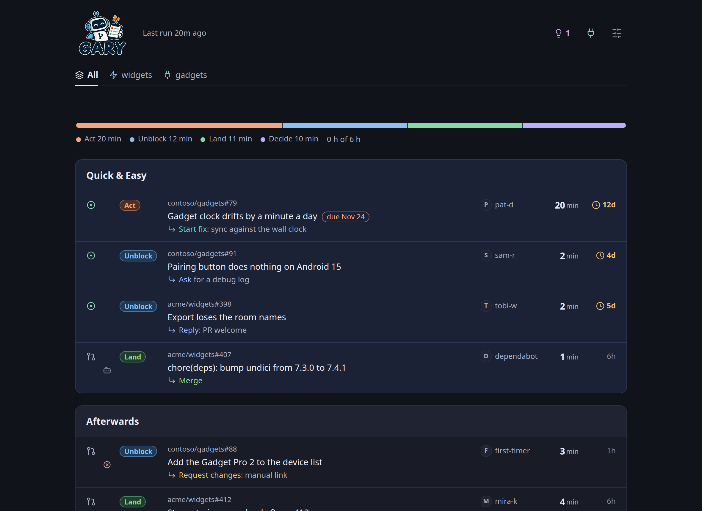
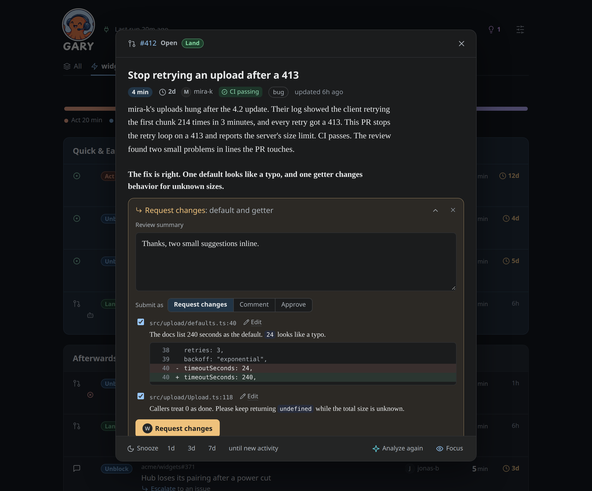
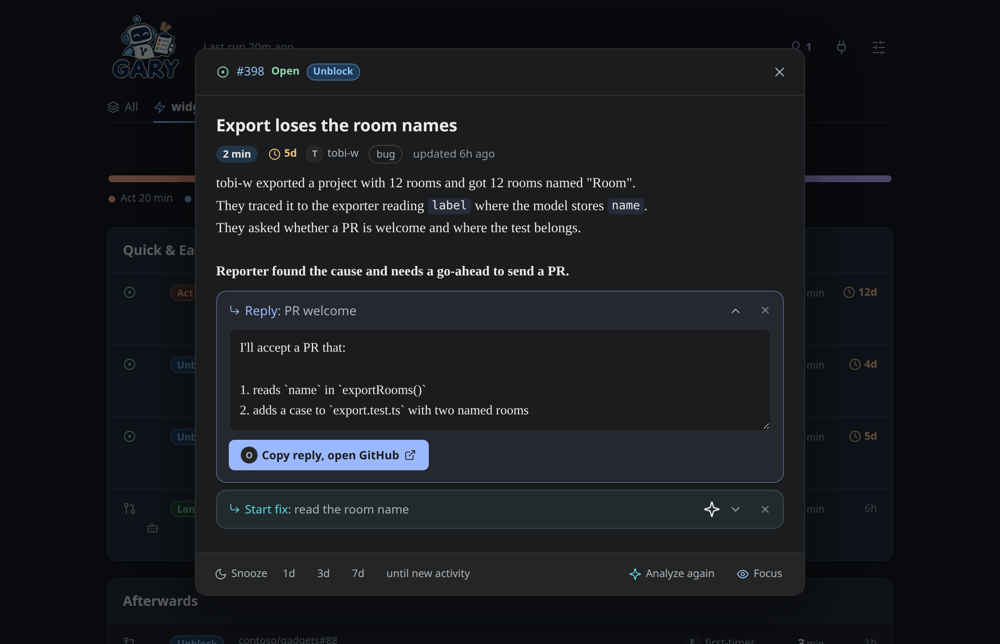

# Working with the board

The board is at `http://gary.localhost:<port>/` or `http://127.0.0.1:<port>/`. The port is in `~/.config/gary/config.json`, 7878 by default.

## The plan

The tab "All" combines your projects. Each project also has its own tab. In "All", an item shows its full ref, like `acme/widgets#412`.

Items are grouped by the attention they need: "Quick & Easy", "Afterwards" and "When you have time". Each item carries one of four categories:

- **Act**: something is due.
- **Unblock**: someone waits on you.
- **Land**: work that is nearly done.
- **Decide**: a question nobody actively waits on.

An item with nothing to do is hidden. It comes back when it changes on GitHub.

An issue or discussion with a fix in progress leaves the groups too. The line "Has a fix in progress" lists it until the fix PR is merged or closed, or the reporter writes again.

## An item

Each item has a verdict, a story of what happened so far, and cards with suggested actions. One card is recommended.

A card shows who acts after your click:

- **You**: replies to people, every close and every merge. The board copies the text and opens the thread on GitHub. You post or merge there.
- **The bot**: reviews with inline comments, requests for logs, labels, transfers. Anything that posts text asks for a second confirm.
- **The agent**: work that takes a session, like a fix with a test, a take-over of a contributor's PR, or addressing review comments.

A finished card collapses and shows its confirmation, like "Done · view on GitHub". An item you handled waits in the line "Handled, waiting for the next run".

## When a suggestion is wrong

Dismiss the card and say why. The agent never offers that kind of action on the item again.

"Analyze again" sends the item back to the agent. You can add a note or answer the agent's open questions first.

## Reviews

On a review card you can uncheck inline comments and edit their text. A suggested code change stays as the agent wrote it.

A review with a finding goes out as "Request changes". A clean PR gets an approval. A switch on the card picks another type.

For each open review thread you choose Fix or Dismiss. Only comments the agent judged valid start on Fix.

Gary's reviews never list formatting problems. When the project's formatter would change a PR, the item shows a badge and a "Format" card. That card commits exactly those fixes to the PR, without taking it over. This needs `autofixCommands` in the profile, see [configuration.md](configuration.md#format-check).

After the agent pushed to a PR, the item offers the decision: merge, a review with what is left, or another pass.

## Replies

A reply card copies the text and opens the thread. You post it yourself.

A reply that asks the reporter for something has a second button that also sets the project's "waiting" label. When you post without it, the next run sets the label.

## Fixes

A "Start fix" card starts an agent that writes a failing test, the fix and a draft PR.

The switch "Ask the reporter to test" is off by default. Without it, a fix PR mentions nobody.

Gary can also start fixes for clear bugs on its own, see [safety.md](safety.md#fixes-without-a-click).

## FYI items

An FYI item on the contributions tab has one button, "Got it". It hides the item until there is news again.

It can also mark the thread's notification as done in your GitHub inbox, see [configuration.md](configuration.md#your-contributions-elsewhere).

## Reviewing on GitHub

You can open an item on GitHub and handle it there. When you return to the board tab, Gary checks the item. A merged or closed item moves to "Handled, waiting for the next run".

## Focus

Focus works on one item 1 on 1 with an agent. The button sits in the footer of every item.

1. The master session looks for a session that already works on the item, like the one with its PR branch checked out. Otherwise it starts a new one in a new worktree.
2. The session reads Gary's analysis, posts a short summary and waits for you.
3. When you tell the session you are done, it sends Gary a summary. Gary analyzes the item again with it.

The session follows Gary's rules. It acts as the bot and drafts text in your name for you to post. It never merges. It posts under your account only when you tell it to.

Gary holds the item meanwhile. No worker, review round or push touches it. The item stays in your plan with the chip "In focus" and a link to the session.

A session that has been quiet for 30 minutes shows as "Focus paused", with "Resume" and "End focus". Gary still touches nothing until you click one of them or archive the session.

## Items Gary could not analyze

Such an item shows one card that opens the thread on GitHub. That happens when the model's safety filter stopped the agent, or the analysis failed three times. "Analyze again" retries.

## Learning

Gary proposes a small rule when you often dismiss the same kind of card, pick the alternative, or rewrite drafts the same way.

Proposals appear behind the lightbulb in the header. You edit, accept or dismiss them. An accepted rule is appended to your profile or `personal.md`.

Once a week Gary checks its rules for ones that repeat, conflict or name things that no longer exist. It proposes each change as a before and after. "Check rules" in the suggestions dialog runs that check sooner.
