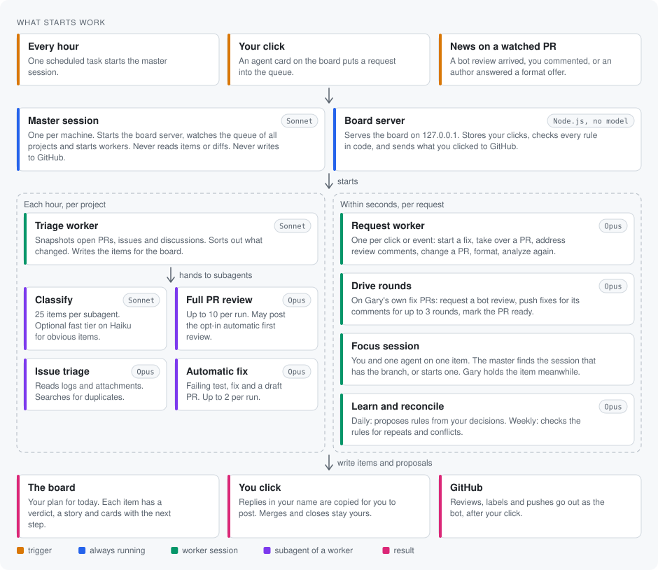

# How Gary runs

## What starts work

- **Every hour**, one scheduled task starts the master session.
- **Your click** on an agent card puts a request into the queue. A worker starts within seconds.
- **Your chat message** from the board's "Talk to Gary" dialog goes into the same queue. The master hands it to a chat session.
- **News on a watched PR** starts a round: a bot review arrived, you commented, or a PR's author answered a format offer.

## Who does what

**The master session** runs once per machine. It starts the board server, watches the queue of all projects and starts workers. It never reads items or diffs, so its context stays small over many hours. It writes nothing to GitHub.

**The board server** is plain Node.js without a model. It serves the board, stores your clicks and checks every rule in code. It is the one place that sends what you clicked to GitHub.

**A triage worker** runs once per hour for each project. It snapshots the open PRs, issues and discussions, and sorts out what changed. Draft PRs stay out, unless someone asked you something there that nobody answered yet. Such a draft gets a reply card and no review until it is marked ready. Subagents do the reading:

- Classification, 25 items per subagent.
- A full review per PR that needs one, up to `maxFullReviewsPerRun`.
- A full triage per issue or discussion, with its logs and attachments.
- A draft fix PR for a clear bug, up to `maxAutoFixesPerRun`.

**A request worker** handles one click or one event: start a fix, take over a PR, address review comments, change a PR, format, or analyze again.

**Drive rounds** run on Gary's own fix PRs. Gary requests a bot review, pushes fixes for its comments and marks the PR ready.

**Local reviewers** read an agent's commits before it pushes: a fresh agent that looks for what is wrong, another model, or a review program of yours. The worker starts them, because a job agent cannot start agents itself. The job judges their findings, fixes the valid ones and commits again, up to `maxLocalPasses` times. Then it pushes. Nothing of it goes to GitHub. With a GitHub review bot and no `review.local` none run, see [configuration.md](configuration.md#local-review-before-a-push).

**A focus session** is you and one agent on one item. Gary holds the item meanwhile.

**A chat session** answers your messages from the board's chat. It explains and changes settings and uses the board's own buttons. It never writes to GitHub.

**Learn and reconcile** run once a day and once a week. They propose rule changes from your decisions.

## Models

The chips in the picture show the defaults. The master, the workers and the classification run on Sonnet. Every review, fix and push runs on Opus. `models` in a `config.json` changes that, see [configuration.md](configuration.md#models).

## Fallbacks

A worker is a child session where the harness supports it. Otherwise it is a headless `claude -p` run. Otherwise the master does the job itself.

A contributions instance runs the same hourly worker with classification only. It has no reviews, no fixes and no writes to GitHub.

[internals.md](internals.md) has the commands, the state files and the server's routes.
